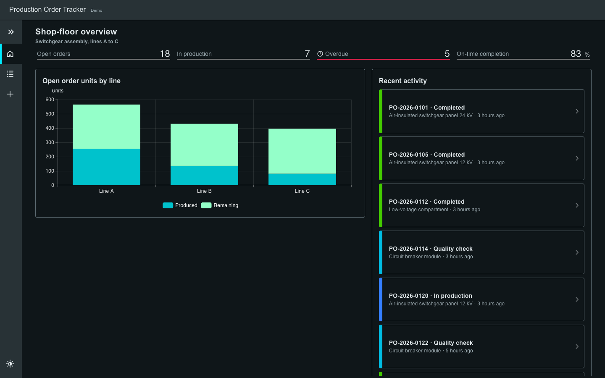
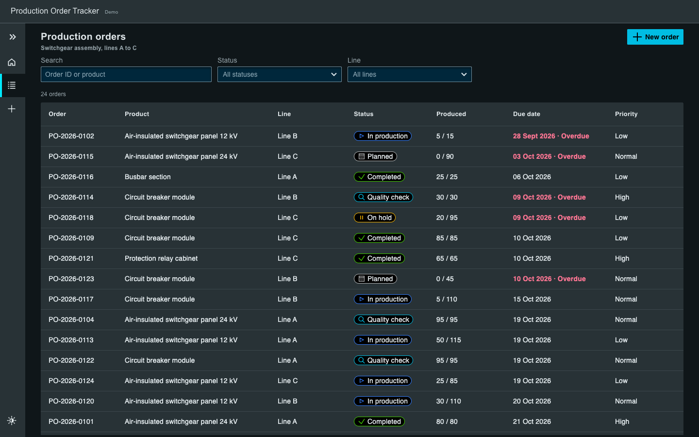
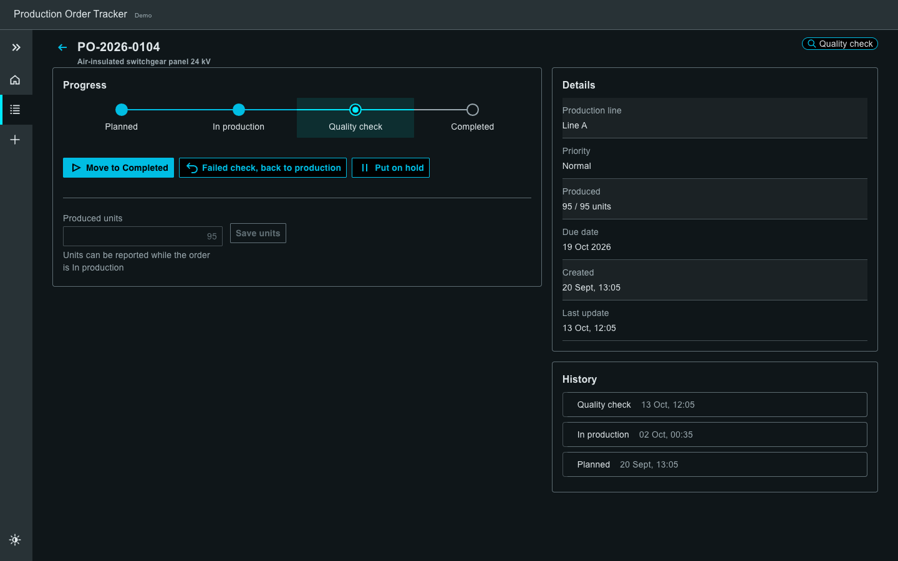
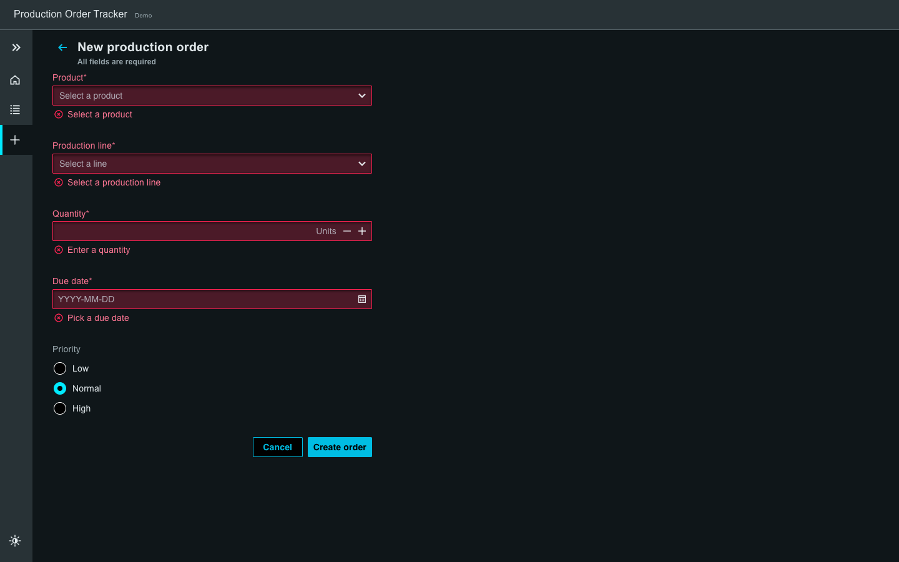
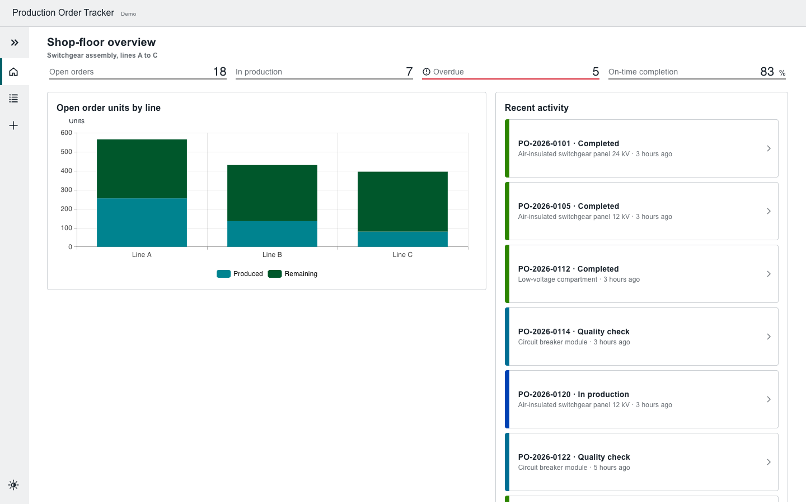

# Production Order Tracker

A small shop-floor application for tracking production orders on a switchgear assembly floor, built with the open-source **[Siemens Industrial Experience (iX)](https://ix.siemens.io)** design system, React 19 and a typed REST API.

**Live demo:** _coming soon_

> Independent demo project built with the open-source Siemens iX design system (MIT). It is not affiliated with or endorsed by Siemens. Product names and data are fictional.



## What it does

- **Dashboard:** KPIs (open, in production, overdue, on-time completion), units per line chart (ECharts with the iX theme) and recent status changes.
- **Orders:** AG Grid table with the iX theme, status pills, overdue highlighting, search and status/line filters stored in the URL.
- **Order detail:** workflow steps (Planned → In production → Quality check → Completed), stage actions, hold/resume, failed-check rework and produced-unit reporting.
- **New order:** validated form; the same zod schema runs in the browser and on the server.
- Light and dark theme (menu toggle), loading / error / empty states, keyboard support in the table, responsive layout.

| Orders | Order detail |
|---|---|
|  |  |

| Form validation | Light theme |
|---|---|
|  |  |

## Stack

| Layer | Tools |
|---|---|
| UI | React 19, TypeScript, Siemens iX 5 (`@siemens/ix-react`), iX icons |
| Data views | AG Grid 33 + `@siemens/ix-aggrid`, ECharts 5 + `@siemens/ix-echarts` |
| Routing | React Router 7 |
| API | Hono 4, zod 4 (in-memory store) |
| Tooling | Vite 8, Vitest 4, pnpm |
| Hosting | Vercel (static site + one serverless function) |

The project started from the [iX React starter](https://github.com/siemens/ix-starter).

## Architecture

```
browser ──fetch /api/*──▶ Hono app (server/app.ts) ──▶ in-memory store (server/store.ts)
   │                              │
   └──── shared/schema.ts ◀───────┘   zod schemas + types used by both sides
         shared/workflow.ts           status transition rules used by both sides
```

- `src/`: React app. Pages are lazy-loaded, so AG Grid and ECharts only download with the pages that use them.
- `server/`: Hono app, store, stats. `server/dev.ts` runs it locally on port 8787.
- `api/index.ts`: Vercel function that serves the same Hono app.
- `shared/`: data model and workflow rules, imported by both the frontend and the API.

## API

| Method | Path | Result |
|---|---|---|
| GET | `/api/orders?status=&line=&q=` | Filtered list, sorted by due date. Unknown filter values return 400. |
| GET | `/api/orders/:id` | 200 or 404 |
| POST | `/api/orders` | 201 + `Location` header; 400 with field issues for invalid or unknown fields |
| PATCH | `/api/orders/:id` | Status and/or produced units. 400 invalid body, 404 unknown order, 409 transition not allowed |
| GET | `/api/stats` | KPIs, units per line, recent activity |

Errors always look like `{ "error": string, "issues"?: [{ "path", "message" }] }`. Unexpected errors are logged on the server and return a generic 500 without internals.

### Workflow rules

- Stages move forward one at a time: Planned → In production → Quality check → Completed.
- An order reaches quality check only when every unit is produced.
- A failed quality check sends it back to production.
- Planned, in-production and quality-check orders can be put on hold; resuming returns to the stage before the hold.
- Produced units can be reported only while the order is in production. Completed orders are final.

## Run locally

```bash
pnpm install
pnpm dev          # API on :8787 and Vite on :5173 (Vite proxies /api)
```

Other scripts:

```bash
pnpm test         # Vitest: workflow rules + API tests
pnpm typecheck    # tsc -b for app, server and config
pnpm build        # typecheck + production build
```

Set `DEMO_LATENCY_MS=800` to slow the API down and see the loading states.

## Tests

`pnpm test` runs 27 tests:

- `shared/workflow.test.ts`: transitions, quality-check rule, hold/resume, overdue logic.
- `server/app.test.ts`: every endpoint through `app.request()`, including 400, 404 and 409 paths. Each test gets a fresh store.

## Design decisions

- **One schema for both sides.** `CreateOrderSchema` validates the form in the browser and the request on the server, so error messages and rules cannot drift apart.
- **Workflow rules in one place.** The UI only offers actions that `shared/workflow.ts` allows, and the API enforces the same rules (409 if a client sends something else).
- **URL as the filter state.** Filters are shareable and survive a reload. The search request is debounced; each fetch has an `AbortController`, so a slow old response cannot overwrite a newer one.
- **Hono for the API.** Small, typed, Web-standard `Request`/`Response`; the same app runs under Node locally, in tests via `app.request()` and on Vercel.
- **HashRouter** (from the starter), so the static deployment needs no SPA rewrite rules.
- **Status never relies on color alone.** Every status pill has an icon and text as well.

## Known limitations

- The store is in memory. On Vercel each function instance has its own copy, and it resets on a cold start, so created orders can disappear. A real version would use a database (e.g. Postgres).
- No authentication or roles.
- No component or end-to-end tests yet; the main flows were checked manually in a browser.

## Next steps

- Postgres persistence and authentication with role-based actions (operator vs. planner).
- Live updates for the dashboard (SSE or WebSocket) instead of loading on page open.
- Component tests (Vitest browser mode) and a Playwright smoke test.
- i18n (English / Turkish).

## How it was built

Built with an AI coding assistant (Claude Code). The work followed a written plan; every change was type-checked, covered by the test suite where it touches the API or workflow rules, and checked in a browser (dark/light theme, mobile width, error and empty states).

## License

MIT. Parts are based on the Siemens iX starter (MIT, Copyright (c) Siemens AG). See [LICENSE](LICENSE).
